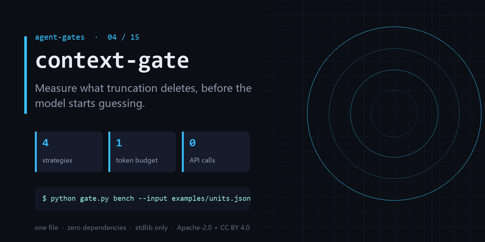

<div align="center">

</div>

<h1 align="center">context-gate</h1>

<p align="center"><b>Measure what truncation deletes, before the model starts guessing.</b><br><sub>one file · zero dependencies · stdlib only</sub></p>

<p align="center"><a href="https://github.com/chenhz01/context-gate/actions/workflows/gate.yml"></a>   </p>

---

## The failure this catches

- Head truncation cut off the final error message, so the model invented a different one.
- Same input, different truncation strategy, answers differ by 2x — nobody knows why.
- 'Just truncate when it overflows' is in the design doc; where it truncates is whoever coded last.

One command, on a file you already have:

```bash
python gate.py bench --input examples/units.json --budget 600
```

<details>
<summary><b>Real output</b> — produced by the bundled <code>examples/</code>, not a mock-up</summary>

```text
units=40 total_tokens=2000 budget=600
strategy            score   weighted   critical   tokens
head               0.2133     0.3000     0.0833      600
tail               0.4133     0.3000     0.5833      600
middle             0.2467     0.3000     0.1667      600
head_tail          0.3467     0.3000     0.4167      600
top_importance     0.5800     0.3000     1.0000      600
hybrid             0.3500     0.2500     0.5000      500
winner: top_importance
```

</details>

## What it does

- Benchmarks head / tail / middle / hybrid against a token budget you set.
- Reports critical-unit survival, not just bytes kept — the number that matters.
- Ships a synthetic generator, so you can get a baseline before you have logs.

## What it does **not** do

- It does not call a model — quality here is measured by unit survival, not answer accuracy.
- You must mark critical units yourself; it cannot infer importance from text.
- It does not implement truncation for you, it tells you which one to implement.

Being explicit here is cheaper than a wrong expectation later.

## Exit codes

`0` = the benchmark ran. `2` = bad input. **This is a measurement, not a gate:** exceeding `--budget` is reported, not enforced. Compare the strategies, then set your own ceiling.

## Install

```bash
git clone https://github.com/chenhz01/context-gate
cd context-gate
python gate.py --help
```

Python 3.9+. Nothing to `pip install` — stdlib only.

## Use it in CI

```yaml
- name: context-gate
  run: python gate.py bench --input examples/units.json --budget 600
```

## Use it as a GitHub Action

`action.yml` is included, so you can call this repo directly as a composite action.

```yaml
# .github/workflows/gates.yml
- uses: actions/checkout@v4

- uses: chenhz01/context-gate@v0.1.2
  with:
    # IMPORTANT: this path is inside YOUR repository.
    # The examples/ in this repo are NOT in your workspace — pass your own files.
    args: "bench --input path/to/units.json --budget 600"
```

Pin the tag (`@v0.1.2`) rather than `@main` — `main` moves.
Check [Releases](https://github.com/chenhz01/context-gate/releases) for the newest tag; `v0.1.0` predates the
fix that makes a mistyped path fail instead of silently passing.

If you omit `args`, the action only prints help and exits 0. It raises a warning
annotation — quoting this gate's own correct usage — so a green check is never
mistaken for "it inspected my files".


## 中文速览

**上下文门** — 在模型开始瞎编之前，先量化截断到底删掉了什么。

- head 截断把最后那段报错切掉了，模型于是开始编一个不存在的错。
- 同一份输入，换个截断策略，答案质量差一倍，但没人知道差在哪。
- 「上下文不够就截断」写在架构文档里，具体截哪里，全凭当时的实现者。

一行命令：`python gate.py bench --input examples/units.json --budget 600`

边界：It does not call a model — quality here is measured by unit survival, not answer accuracy.

## The gates

| # | gate | what it stops |
|---|---|---|
| 02 | **[loop-gate](https://github.com/chenhz01/loop-gate)** | Find where your agent looped, before it burns another run |
| 03 | **[permission-gate](https://github.com/chenhz01/permission-gate)** | Score how much more your agent can do than it should |
| 04 | **context-gate** ← you are here | Measure what truncation deletes, before the model starts guessing |
| 05 | **[instruction-gate](https://github.com/chenhz01/instruction-gate)** | Two of your instructions contradict each other. This finds them |
| 06 | **[output-gate](https://github.com/chenhz01/output-gate)** | Before AI-written text ships, run the four checks it always fails |
| 07 | **[memory-expiry-gate](https://github.com/chenhz01/memory-expiry-gate)** | Give every memory a TTL, then prove the expiry semantics actually hold |
| 08 | **[drift-gate](https://github.com/chenhz01/drift-gate)** | When embeddings drift, retrieval quietly rots. Fingerprint it |
| 09 | **[price-gate](https://github.com/chenhz01/price-gate)** | Your cost model is only as good as the price table under it |
| 10 | **[complexity-ceiling](https://github.com/chenhz01/complexity-ceiling)** | Per-file complexity budgets that fail the build instead of the reviewer |
| 11 | **[deadcode-gate](https://github.com/chenhz01/deadcode-gate)** | Quantify how much of the repo is dead, instead of guessing |
| 12 | **[docrot-gate](https://github.com/chenhz01/docrot-gate)** | Docs don't die at once. They rot one stale command at a time |
| 13 | **[leak-gate](https://github.com/chenhz01/leak-gate)** | Scan for internal detail before the doc leaves the building |
| 14 | **[backup-gate](https://github.com/chenhz01/backup-gate)** | A backup you have never verified is a rumor |
| 15 | **[trail-gate](https://github.com/chenhz01/trail-gate)** | Hash-chained agent audit trail — and it verifies its own chain |

## License

- Code: **Apache-2.0** — see [LICENSE](LICENSE)
- Docs and example data: **CC BY 4.0** — see [LICENSE-SPEC](LICENSE-SPEC)

Attribution required when you redistribute the documentation; code can be used commercially
without a separate agreement. See [NOTICE](NOTICE).
